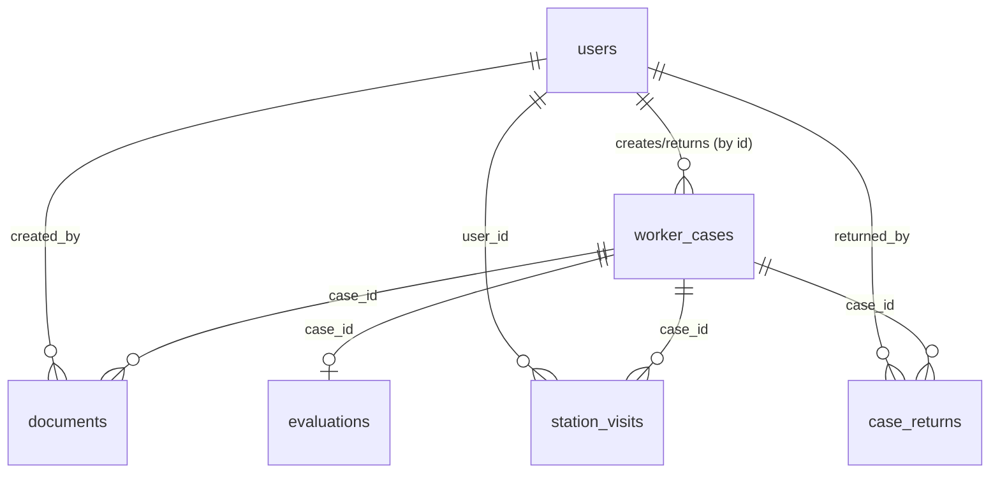

# تطبيق اختبار العمال — توثيق المشروع (العربية)

> يصف هذا الملف الكود كما هو موجود فعلياً في المستودع، وليس النماذج البصرية في `docs/PRD.md` أو `docs/DESIGN.md` أو مرجع DGA HTML. أي متطلب ورد في خطط التطوير فقط يُذكر صراحةً بذلك. الملف المرافق بالإنجليزية هو `docs/doc_en.md`.

---

## 1. نظرة عامة على المشروع

| البند | القيمة |
|---|---|
| اسم المشروع | تطبيق اختبار العمال / منصة اختبارات العمالة |
| الغرض | تحويل اختبار العامل من الورق إلى رحلة رقمية من أربع محطات، والمخرج ملف PDF عربي واحد لكل عامل يُسلَّم للإدارة |
| المستخدمون المستهدفون | أربعة أدوار Named: الاستقبال، المختبر النظري، المختبر العملي، رفع البيانات |
| الرحلة الأساسية | الاستقبال ← المختبر النظري ← المختبر العملي ← مراجعة البيانات ← توليد PDF وتنزيله وطباعته |
| المستودع | `/home/ammar/Documents/wpdf` |
| النطاق | MVP — جميع مهام `docs/PLAN.md` موسومة `[x]` |

يعمل النظام على سيرفر محلي داخل الشبكة الداخلية، مع جهاز لكل محطة. لا يوجد أي ربط بمنصة خارجية؛ ويتم الإدخال في المنصة الأخرى يدوياً خارج التطبيق.

المخرج الوحيد هو ملف PDF عربي من سبع صفحات يحتوي بيانات العامل وأوقات المحطات وخمس صور ونموذج التقييم العملي بتوقيعين.

---

## 2. المزايا المُنفَّذة حالياً

ما تم التحقق منه في الكود والاختبارات:

- **المصادقة (Laravel Breeze):** تسجيل الدخول والتسجيل والخروج وتأكيد البريد وإعادة تعيين كلمة المرور وتغييرها وتأكيدها وتعديل الملف الشخصي. أُضيف عمود `role` إلى جدول `users`.
- **الهبوط والتنقل حسب الدور:** الدالة `Role::landRoute()` ترسل الاستقبال إلى `/reception` والمراجعة إلى `/review` والنظري والعملي إلى `/dashboard`؛ وروابط القائمة تتغير حسب الدور.
- **الاستقبال:** إنشاء ملف باسم العامل ورقم الجواز ورقم تذكرة فريد؛ ثلاث صور (`worker_photo`, `passport`, `ticket`)؛ التقاط بالكاميرا **أو** رفع من الجهاز؛ رفض رقم التذكرة المكرر برسالة عربية؛ قائمة متطلبات وقفل انتقال في السيرفر؛ قائمة الحالات المَرجعة مع الملاحظة وإعادة إرسال مباشرة للمراجعة.
- **البحث عن الحالة:** البحث برقم التذكرة، عرض الحالة بالعربية، وروابط المعالجة في النظري والعملي عند تطابق الحالة.
- **المحطة النظرية:** قائمة حالات قيد المعالجة مع بحث فوري بالاسم أو التذكرة أو الجواز، رابط مباشر للحالة، صورة `theory_photo` واحدة، ملخص المحطة، قفل الانتقال، شارة مُرجَع وزر إعادة الإرسال.
- **المحطة العملية:** قائمة حالات مع بحث فوري وشارات الإرجاع، صورة `practical_photo` واحدة، نموذج ثابت من 13 معياراً (المهمة + الصعوبة + الدرجات)، توقيعان على الشاشة يُقفلان بعد التوقيع، ملخص المحطة، قفل الانتقال، شارة مُرجَع وزر إعادة الإرسال.
- **محطة المراجعة:** قائمة حالات `review`، قائمة الحالات التي لها PDF، عرض المستندات مرتبة، عرض التقييم، الإرجاع إلى إحدى محطات الاستقبال أو النظري أو العملي بملاحظة نصية (500 حرف كحد أقصى)، تحذير مسح التوقيعين عند الإرجاع للعملي، توليد PDF والتنزيل والطباعة، شارات "عاد بعد التصحيح"، وملخص المحطة.
- **آلة الحالات:** كل تغيير حالة يمر عبر `App\Services\CaseStateMachine`، ويُبلَّغ عن النواقص عبر `App\Services\StationCompletion`.
- **الـPDF:** ملف A4 عربي RTL من سبع صفحات يُنتَج عبر Spatie Browsershot من قالب Blade، مع تذييل ترقيم الصفحات، ويُحفظ على التخزين الخاص.
- **خدمة الصور الخاصة:** تُخزَّن الصور على القرص `local` ولا تُقدَّم إلا عبر مسار محمي بالمصادقة.
- **وسيط وصول المحطات:** `station:reception` و `station:review` مُسجَّلان في `bootstrap/app.php` ويُطبَّقان على هذين المسارين.
- **الاختبارات:** 213 اختباراً / 720 تأكيداً ناجحة وقت كتابة هذا الملف.

---

## 3. التقنيات المستخدمة

الإصدارات من `composer.json` و `package.json` و `composer show --direct` داخل حاوية Sail:

| الطبقة | الحزمة / التقنية | القيد | الإصدار المُثبَّت |
|---|---|---|---|
| اللغة | PHP | `^8.3` | 8.5.x في حاوية `sail-8.5/app` |
| الإطار | `laravel/framework` | `^13.17` | 13.43.0 |
| الواجهة (السيرفر) | `livewire/livewire` | `^4.0` | 4.4.8 |
| الواجهة (المتصفح) | Alpine.js | `^3.4.2` (npm) | مُضمَّن تلقائياً بواسطة Livewire 4؛ ملف `resources/js/app.js` فارغ قصداً |
| التنسيق | `tailwindcss` | `^4.3.5` | إعداد `@theme` بنمط CSS-first، واتجاه RTL |
| إضافة التنسيق | `@tailwindcss/forms` | `^0.5.2` | مُثبَّتة |
| البناء | `vite` / `laravel-vite-plugin` / `@tailwindcss/vite` | `^8.0.0` / `^3.1` / `^4.3.5` | مُثبَّتة |
| الخطوط | `@fontsource/ibm-plex-sans-arabic`، `@fontsource/material-symbols-outlined` | `^5.3.0`، `^5.3.9` | مستضافة محلياً (بلا CDN) |
| الـPDF | `spatie/browsershot` | `^5.5` | 5.5.0، يحتاج `/usr/bin/google-chrome-stable` |
| المصادقة | `laravel/breeze` | `^2.4` | 2.4.2 |
| بيئة التطوير | `laravel/sail` | `^1.71` | 1.71.0 مع خدمة MySQL 8.4 |
| قاعدة البيانات | MySQL | — | `mysql:8.4` في `compose.yaml`؛ SQLite كبديل في الإعدادات |
| الطوابير | مشغّل `database` | `QUEUE_CONNECTION=database` | مُعدّ؛ لا توجد أصناف مهام في `app/Jobs` |
| الاختبارات | `phpunit/phpunit` | `^12.5.12` | 12.5.45، تُشغَّل عبر `php artisan test` |
| المنسّق | `laravel/pint` | `^1.27` | 1.32.3 |
| أدوات تشخيصية | `puppeteer` | `^25.18.1` | مُثبَّتة كحزمة npm، لا يستخدمها كود التطبيق |
| أخرى | `laravel/boost`, `laravel/pail`, `laravel/pao`, `fakerphp/faker`, `mockery/mockery`, `nunomaduro/collision`, `laravel/tinker` | انظر `composer.json` | مُثبَّتة |

ملاحظة: ينص `AGENTS.md` على أن إطار الاختبارات Pest، لكن المجموعة الفعلية تستخدم دوال PHPUnit بصيغة `test_*` مع `phpunit/phpunit` في `composer.json`.

---

## 4. المعمارية

المعمارية MVC مع فصل منطق العمل إلى Actions وServices وQueries.

```text
المتصفح (Blade عربي RTL + Livewire + Alpine مضمّن)
        │  طلب HTTP / تحديث Livewire
        ▼
routes/web.php ── auth ── station:<role> (الاستقبال والمراجعة فقط)
        │
        ├── مكوّن Livewire (app/Livewire/*) أو متحكم رفيع
        │        ├── يتحقق من المدخلات (validate / Validator / Form Request)
        │        ├── يستدعي Actions (app/Actions/*)
        │        └── يستدعي Services (app/Services/*)
        │
        ├── Actions: CreateWorkerCase, StoreCaseDocument, SaveEvaluation,
        │            SignEvaluation, ReturnCase, FindCaseByTicket, GenerateCasePdf
        ├── Services: CaseStateMachine, StationCompletion
        ├── Queries: PendingReceptionCases, PendingTheoryCases, PendingPracticalCases
        └── Models: WorkerCase, Document, Evaluation, StationVisit, CaseReturn, User
                 │
                 ▼
        MySQL محلي (Sail) + تخزين خاص (storage/app/private)
                 │
                 ▼
        Browsershot + Chrome ← ملف PDF واحد لكل حالة
```

القواعد المتبعة فعلياً في الكود:

- الموديلات تحتوي على العلاقات والتحويلات (casts) ومساعدات حالة بسيطة فقط.
- المتحكمات رفيعة (تنزيل وطباعة PDF، خدمة الصورة الخاصة، ملف Breeze الشخصي).
- تغيير الحالة يحدث فقط عبر `CaseStateMachine`.
- المشاهد تحتوي على الواجهة وAlpine المضمّن؛ والاستعلامات في مكوّنات Livewire أو `App\Queries` وليس داخل Blade.

---

## 5. هيكل المشروع

```text
app/
├── Actions/          عمليات العمل (إنشاء حالة، حفظ مستند، حفظ/توقيع تقييم،
│                     إرجاع حالة، بحث برقم التذكرة، توليد PDF)
├── Enums/            CaseStatus, Difficulty, Role, Station مع أسماء عربية
├── Exceptions/       IncompleteStationException (يحمل الحالة والمحطة والنواقص)
├── Http/
│   ├── Controllers/  متحكمات رفيعة: PDF، المستند الخاص، ملف Breeze، Auth/
│   ├── Middleware/   EnsureStationAccess (الاسم المستعار station:)
│   └── Requests/     ProfileUpdateRequest الخاص بـBreeze
├── Livewire/         Reception, TheoryStation, PracticalStation, ReviewStation,
│                     CaseSearch, CameraCapture, مكوّنات *PendingCases
├── Models/           موديلات Eloquent والعلاقات
├── Queries/          استعلامات قوائم الحالات مع البحث الفوري
└── Services/         CaseStateMachine, StationCompletion
bootstrap/app.php      تسجيل الاسم المستعار station
config/                filesystems, livewire, database, queue, wpdf وإعدادات Breeze
database/
├── migrations/       جميع جداول النطاق وجداول Breeze والكاش والمهام
├── factories/        مصانع الموديلات
└── seeders/          DatabaseSeeder (أربعة حسابات بالأدوار)
docs/                 PRD.md, PLAN.md, DATA_MODEL.md, DESIGN.md وهذا التوثيق
resources/
├── css/app.css       رموز Tailwind 4 في @theme، أنماط أساسية، أصناف .dga-*
├── js/app.js         فارغ قصداً — Livewire 4 يشغّل Alpine بنفسه
└── views/            تخطيطات Blade، المصادقة والملف الشخصي، مشاهد Livewire، pdf/case-report.blade.php
routes/               web.php, auth.php, console.php
spikes/pdf-spike/     مخرجات تجربة PDF في الخطوة صفر (ليست جزءاً من التشغيل)
storage/app/private/  الصور والـPDF المولّدة (لا تُخزَّن في القرص العام أبداً)
tests/Feature/        اختبارات HTTP وLivewire والـPDF والأدوار والتخزين والمخطط
```

---

## 6. المحطات وسير العمل

### المسار الطبيعي

| الخطوة | قيمة الحالة | المطلوب للاكتمال | التالي |
|---|---|---|---|
| الاستقبال | `reception` | الاسم والجواز والتذكرة و`worker_photo` و`passport` و`ticket` | `theory` |
| المختبر النظري | `theory` | صورة `theory_photo` | `practical` |
| المختبر العملي | `practical` | `practical_photo` وصف تقييم وتوقيعان (`signed_at`) | `review` |
| مراجعة البيانات | `review` | كل المستندات موجودة والتقييم موقَّع | توليد PDF |
| تم التسليم | — | تنزيل أو طباعة بواسطة موظف المراجعة | تسليم يدوي خارج التطبيق |

`CaseStateMachine::advance()` يعيد التحقق من `StationCompletion::missing()` في السيرفر ويرمي `IncompleteStationException` برسالة عربية تسرد النواقص. الحالتان `completed` و `cancelled` قيمتان صالحتان في الـEnum، لكن لا يوجد كود تطبيقي يضع الحالة فيهما حالياً. وتوليد الـPDF لا يغيّر حالة الملف.

### مسار الإرجاع والتصحيح

```text
review ──ReturnCase(case, station, note)──► returned
                                              │
                          المحطة المستهدفة تُصلح مستنداتها
                                              │
                       resubmitToReview() ────► review ──► توليد PDF
```

- لا يمكن إرجاع حالة إلا وهي في `review`، والمحطة الهدف يجب أن تكون `reception` أو `theory` أو `practical` (وليس `review`).
- الملاحظة إلزامية وبحد أقصى 500 حرف في نموذج Livewire.
- `ReturnCase` يسجّل صفاً في `case_returns` ويجعل الحالة `returned` ويحذف **صفوف `documents` التابعة للمحطة المستهدفة** داخل معاملة قاعدة بيانات.
- ملفات الصور نفسها لا يحذفها `ReturnCase`؛ تُحذف فقط عندما يستبدل `StoreCaseDocument` مستنداً من نفس النوع أثناء إعادة التصوير.
- إذا كانت الهدف **العملي**، فإن `evaluator_signature` و `worker_signature` و `signed_at` تُضبط كلها إلى `null`. تبقى المهمة والصعوبة ودرجات المعايير الـ13، لكن يجب رسم التوقيعين مجدداً.
- الإرجاع إلى الاستقبال أو النظري لا يمس توقيعات التقييم.
- بعد التصحيح تستدعي المحطة المستهدفة `resubmitToReview()`؛ وبعدها فقط يمكن لمحطة المراجعة اختيار الملف مجدداً.
- تعرض واجهة المراجعة شارة "عاد بعد التصحيح" عند وجود سجلات `returns`.

---

## 7. الأدوار والصلاحيات

| الدور | قيمة الـEnum | صفحة الهبوط | القائمة | الإجراءات المسموحة |
|---|---|---|---|---|
| الاستقبال | `reception` | `reception` | الاستقبال + بحث القضايا | إنشاء الحالات، تصوير 3 مستندات، التقدم، إصلاح الحالات المَرجعة، إعادة الإرسال |
| النظري | `theory` | `dashboard` | قائمة النظري قيد المعالجة عبر اللوحة | تصفح القائمة، اختيار حالة، تصوير، تقدم، إعادة إرسال |
| العملي | `practical` | `dashboard` | قائمة العملي قيد المعالجة عبر اللوحة | تصفح القائمة، حفظ التقييم، التوقيعان، تصوير، تقدم، إعادة إرسال |
| المراجعة | `review` | `review` | محطة المراجعة | عرض حالات المراجعة، الإرجاع لمحطة واحدة، توليد PDF وتنزيله وطباعته |

التطبيق الفعلي للصلاحيات:

- `GET /reception` يستخدم `station:reception` و `GET /review` يستخدم `station:review`. عند عدم تطابق الدور يحدث `abort(403, 'غير مصرح لك بالدخول لهذه المحطة')`.
- `GET /theory/{case?}` و `GET /practical/{case}` و `GET /search` و `GET /documents/{document}` ومسارات PDF والملف الشخصي محمية بـ`auth` فقط — لا يوجد تحقق إضافي من الدور في السيرفر على هذه المسارات. هذا قيد معروف (انظر §16).
- التسجيل مفتوح للضيوف؛ والمستخدم الجديد بلا دور ويهبط إلى `/dashboard` مع تنبيه "لم يتم تحديد محطة لمستخدمك بعد".

---

## 8. مخطط قاعدة البيانات

أسماء الجداول والأعمدة تتبع `docs/DATA_MODEL.md`؛ والأنواع أدناه تعكس الـmigrations كما نُفّذت.

### `users`
`id`, `name`, `email` (فريد), `email_verified_at` قابل للفراغ, `password`, `rememberToken`, `role` من نوع enum (`reception|theory|practical|review`, قابل للفراغ), `created_at`, `updated_at`.

### `worker_cases`
`id`, `full_name`, `passport_number`, `ticket_number` (فريد), `status` enum (`reception|theory|practical|review|completed|returned|cancelled`, قابل للفراغ), timestamps.

### `documents`
`id`, `case_id` مفتاح خارجي ← `worker_cases`, `station` enum (`reception|theory|practical`), `type` نصي, `path` نصي, `created_by` مفتاح خارجي ← `users`, `created_at` قابل للفراغ. لا يوجد `updated_at`.

أنواع المستندات المستخدمة: `worker_photo`, `passport`, `ticket` (الاستقبال)، `theory_photo` (النظري)، `practical_photo` (العملي).

### `evaluations`
`id`, `case_id` فريد ومفتاح خارجي ← `worker_cases`, `task`, `difficulty` enum (`easy|medium|hard`), `scores` JSON (مفاتيح 1–13 وقيم 0–5), `evaluator_name`, `evaluator_id_number` (يُخزَّن حالياً بريد المقيّم), `evaluator_signature` و `worker_signature` من نوع `text` قابل للفراغ بصيغة data-URL, `signed_at` قابل للفراغ, `created_at` قابل للفراغ. لا يوجد `updated_at`.

### `station_visits`
`id`, `case_id` مفتاح خارجي, `station` enum (`reception|theory|practical|review`), `user_id` مفتاح خارجي, `started_at` قابل للفراغ, `completed_at` قابل للفراغ. بلا timestamps. الجدول والعلاقة موجودان، لكن لا يكتب كود التطبيق صفوفاً فيه؛ وأوقات الـPDF تُؤخذ من `created_at` للمستندات ومن `signed_at`.

### `case_returns`
`id`, `case_id` مفتاح خارجي, `returned_to_station` enum (`reception|theory|practical`), `note` نصي, `returned_by` مفتاح خارجي ← `users`, `created_at` قابل للفراغ. لا يوجد `updated_at`.

### جداول الإطار
`password_reset_tokens`, `sessions`, `cache`, `cache_locks`, `jobs`, `job_batches`, `failed_jobs` من migrations الأساسية لـBreeze/Laravel.

### الـEnums
`CaseStatus` (7 قيم بأسماء عربية)، `Station` (4 قيم بأسماء عربية)، `Role` (4 قيم بتسميات عربية وصفحة هبوط)، `Difficulty` (3 قيم).

### هيكل التقييم

| القسم | أرقام المعايير |
|---|---|
| فهم المشكلة وسير العملية | 1–5 |
| الأمن والسلامة | 6–9 |
| الأدوات والمعدات | 10–11 |
| الصحة والنظافة | 12–13 |

المقياس: `0` غير مؤدٍ، `1` ضعيف، `2` أقل من المتوسط، `3` مرضٍ، `4` جيد، `5` ممتاز. لا يوجد حد نجاح أو رسوب ولا تقييم كلي؛ الحد الأقصى 65 حسابياً فقط. المعايير ثوابت في `SaveEvaluation::SECTIONS` ولا يوجد محرر نماذج.

### مخطط العلاقات



---

## 9. المكوّنات الأساسية

### التقاط الصورة (`app/Livewire/CameraCapture.php`, `resources/views/livewire/camera-capture.blade.php`)
- منطق الكاميرا مضمّن بالكامل بـAlpine داخل Blade، و`resources/js/app.js` فارغ قصداً.
- يستخدم `getUserMedia({video:{facingMode:'environment'}})` مع بديل لأي كاميرا، ويعرض أخطاء عربية عند الرفض أو عدم التوفر، ويوفّر زر **"رفع من الجهاز"** كبديل.
- الضغط في المتصفح: رسم على canvas بأقصى بُعد 1600 بكسل وجودة JPEG 0.72؛ مع تحذير من الصورة السوداء قبل الاعتماد.
- كلا المسارين يصبّان في `saveImage(string $imageData)`. ترتيب التحقق في السيرفر: تعبير نمطي صارم لـ`data:image/(jpeg|png);base64` ← `base64_decode(..., true)` صارم ← حجم ≤ 5 ميجابايت ← فحص المحتوى بـ`getimagesizefromstring()`.
- الحفظ عبر `StoreCaseDocument` في المسار `cases/{caseId}/{station}/{type}.{ext}` على القرص `local`؛ وإعادة التصوير لنفس النوع تحذف الملف القديم وتحدّث الصف.
- يُرسل حدث `case-document-stored` لتحديث قائمة المتطلبات في المكوّن الأب؛ مستمعات Livewire 4 تستخدم `#[On(...)]`.

### لوحة التوقيع (`resources/views/livewire/partials/signature-pad.blade.php` وسكربت مضمّن في `practical-station.blade.php`)
- canvas بأبعاد 600×150 مع أحداث pointer، يُخرج `data:image/png;base64,...` إلى حقل مخفي مرتبط بـ`wire:model`.
- `SignEvaluation` يتحقق من نمط data-URL وحد أقصى 2 ميجابايت بعد الفك، ثم يضبط `signed_at`. وبعد التوقيع يرفض كل من `SaveEvaluation` و `SignEvaluation` أي تعديل برسائل عربية.

### لوحات المحطات والجداول
- `App\Queries\PendingTheoryCases` و `PendingPracticalCases` تشمل الحالات قيد المعالجة والمَرجعة إلى تلك المحطة؛ و`PendingReceptionCases` تعرض المَرجعة إلى الاستقبال فقط.
- البحث الفوري يطابق الاسم والتذكرة والجواز. وتعرض الجداول شارات الإرجاع والملاحظة ومَن أعاد الملف وحالة الصورة عبر `withExists`.

### ملخص المحطة (`resources/views/components/station-summary.blade.php`)
يعرض اسم المحطة الحالية ودور المستخدم والمتطلبات المكتملة والناقصة مع العدّ، وحالة الانتقال ("ناقص" أو "مكتمل" أو "جاهز للمحطة التالية" مع اسم المحطة التالية).

### توليد الـPDF (`app/Actions/GenerateCasePdf.php`, `resources/views/pdf/case-report.blade.php`)
- يتحقق من وجود الصور الخمس والتقييم الموقَّع قبل العرض، ويرمي `LogicException` تسرد النواقص.
- يعرض قالب Blade عربي RTL ويُضمّن الصور كـdata-URLs، ثم يستدعي Browsershot بصيغة A4 ومسار Chrome صريح و`--no-sandbox --disable-dev-shm-usage` وانتظار 500 مللي ثانية واكتمال الشبكة.
- يحفظ في `cases/{caseId}/pdf/{ticket}_{Y-m-d}_v1.pdf` على القرص الخاص.

### متحكم صورة المستند (`app/Http/Controllers/DocumentImageController.php`)
مسار `GET /documents/{document}` محمي بالمصادقة؛ يتحقق من وجود الحالة والملف الخاص ثم يعيد استجابة تخزين مع نوع MIME المكتشف.

### إجراء إرجاع الحالة (`app/Actions/ReturnCase.php`)
داخل معاملة قاعدة بيانات: يستدعي `CaseStateMachine::returnTo()` ويكتب صف `case_returns` ويحذف صفوف مستندات المحطة الهدف ويمسح حقول التوقيعات الثلاثة عند الإرجاع للعملي.

---

## 10. المسارات

جميع المسارات أدناه في `routes/web.php` ما لم يُذكر غير ذلك. مسارات مصادقة Breeze من `routes/auth.php`.

| الطريقة | المسار | المعالج | الوسيط / الدور | الغرض |
|---|---|---|---|---|
| GET | `/` | closure ← `welcome` | عام | الصفحة الرئيسية |
| GET | `/dashboard` | closure ← `dashboard` | `auth`, `verified` | لوحة حسب الدور؛ جداول النظري والعملي |
| GET/POST | `/login` | `AuthenticatedSessionController` | `guest` | الدخول مع تحويل حسب الدور |
| GET/POST | `/register` | `RegisteredUserController` | `guest` | التسجيل (المستخدم الجديد بلا دور) |
| GET/POST | `/forgot-password`, `/reset-password/{token}` | متحكمات Breeze | `guest` | إعادة تعيين كلمة المرور |
| GET | `/verify-email...`, POST `/email/verification-notification` | متحكمات Breeze | `auth` | تأكيد البريد |
| GET/POST | `/confirm-password`, PUT `/password`, POST `/logout` | متحكمات Breeze | `auth` | تأكيد/تغيير كلمة المرور والخروج |
| GET | `/reception` | `App\Livewire\Reception` | `auth`, `station:reception` | إنشاء الحالات وتصوير مستندات الاستقبال |
| GET | `/search` | `App\Livewire\CaseSearch` | `auth` | البحث برقم التذكرة |
| GET | `/theory/{case?}` | `App\Livewire\TheoryStation` | `auth` | قائمة ومعالجة النظري |
| GET | `/practical/{case}` | `App\Livewire\PracticalStation` | `auth` | تقييم وتوقيعات العملي |
| GET | `/review` | `App\Livewire\ReviewStation` | `auth`, `station:review` | المراجعة والإرجاع والـPDF |
| GET | `/documents/{document}` | `DocumentImageController@show` | `auth` | تقديم صورة خاصة |
| GET | `/pdf/{case}` | `CasePdfController@download` | `auth` | تنزيل أحدث PDF |
| GET | `/pdf/{case}/print` | `CasePdfController@print` | `auth` | عرض PDF للتطبيع |
| GET/PATCH/DELETE | `/profile` | `ProfileController` | `auth` | ملف Breeze الشخصي |

---

## 11. التخزين والـPDF

- `config/filesystems.php`: القرص الافتراضي `local` وجذره `storage/app/private`. القرص `public` موجود في الإعدادات لكنه لا يُستخدم لصور العمال.
- مسار الصورة: `cases/{case_id}/{station}/{type}.{jpg|png}` على القرص الخاص، ويُخزَّن في قاعدة البيانات المسار النسبي فقط.
- مسار PDF: `cases/{case_id}/pdf/{ticket_number}_{Y-m-d}_v1.pdf`؛ ويختار المتحكم أحدث ملف `.pdf` معجمياً في ذلك المجلد للتنزيل والطباعة.
- اسم PDF يُولَّد بالإصدار `_v1` في كل مرة؛ لا توجد واجهة إصدارات ولا حالة "تم التسليم".
- يحتاج Browsershot إلى Google Chrome في المسار `/usr/bin/google-chrome-stable` (مثبَّت عبر `docker/Dockerfile`)؛ والوسيطان `no-sandbox` و `disable-dev-shm-usage` مطلوبان داخل الحاوية.
- قالب الـPDF باتجاه `dir="rtl"` ولغة `lang="ar"`، ويستخدم IBM Plex Sans Arabic مستضافة محلياً مع بدائل Noto، وصفحات A4 مقاس 210×297 ملم، وتذييل "منصة اختبارات العمالة — صفحة x من y".
- ترتيب الصفحات: (1) بيانات العامل وأوقات المحطات، (2) صورة العامل، (3) الجواز، (4) التذكرة، (5) صورة النظري، (6) صورة العملي، (7) جدول التقييم والتوقيعان.
- الصفحة الأولى بلا أسماء موظفين ولا إصدار؛ والإصدار يظهر في اسم الملف فقط. وتعرض صفحة التقييم اسم المقيّم ورقم هويته.

---

## 12. نظام التصميم

الواجهة عربية RTL بالكامل، و`resources/css/app.css` هو المصدر المعتمد لرموز التصميم (ملف `docs/DESIGN.md` الأقدم يعرض ألواناً وخطوطاً قديمة غير مطابقة للكود).

| العنصر | التنفيذ الفعلي |
|---|---|
| الخط | IBM Plex Sans Arabic بأوزان 300–700 عبر `@fontsource` ومتغير `--font-sans` |
| الأيقونات | Material Symbols Outlined عبر `@fontsource` مستضافة محلياً |
| الأساسي | `#004328` (`primary`)، الحاوية `#0d5c3a`، الفاتح `#8ad2a7` |
| الكحلي/الحبر | `#101b30` / `#191c1e`؛ والأسطح `#f7f9fb` إلى `#ffffff` |
| الدلالي | `error #ba1a1a`، و`success` = لون الحاوية الأساسية، و`warning` = `#664d00` |
| التخطيط | شريط جانبي أيمن ثابت (`w-72` = 288 بكسل) وشريط علوي ثابت (`h-16` = 64 بكسل) ومحتوى بحشو؛ والقائمة الجانبية تُفتح على الجوال بـAlpine |
| المكوّنات | `.dga-card`, `.dga-card-header`, `.dga-card-body`, `.dga-btn*`, `.dga-badge`, `.dga-table` |
| الاستدارة | أنصاف أقطار MD3 صغيرة (`--radius`, `--radius-lg`, `--radius-xl`)؛ و`rounded-full` يستخدم القيمة الكاملة الافتراضية في Tailwind |

لا توجد في الواجهة رموز QR أو OCR أو تحقق حيوي أو شعارات منصات حكومية، ولا تُستدعى خدمات خارجية.

---

## 13. إعداد التطوير المحلي

```bash
# 1. تشغيل Sail (التطبيق على المنفذ 80، MySQL 8.4، Mailpit)
cp .env.example .env
./vendor/bin/sail up -d

# 2. تثبيت تبعيات PHP وJS
./vendor/bin/sail composer install
./vendor/bin/sail npm install

# 3. مفتاح التطبيق، migrations، حسابات تجريبية، بناء الأصول
./vendor/bin/sail php artisan key:generate
./vendor/bin/sail php artisan migrate --force
./vendor/bin/sail php artisan db:seed
./vendor/bin/sail npm run build
```

تُخدَم التطبيقات على `http://localhost/` عند `APP_PORT=80` (ملف `.env` الحالي يضبط `APP_URL=http://localhost:8000` وهذا يؤثر على توليد الروابط فقط؛ وSail يعيّن المنفذ 80 افتراضياً). وتستخدم الاختبارات قاعدة `testing` المنفصلة التي ينشئها سكربت تهيئة MySQL في Sail.

الحسابات التي ينشئها `DatabaseSeeder.php` (كلمة المرور `password123` للجميع):

| الدور | البريد |
|---|---|
| الاستقبال | `reception@wpdf.test` |
| النظري | `theory@wpdf.test` |
| العملي | `practical@wpdf.test` |
| المراجعة | `review@wpdf.test` |

> ملف `README.md` يحمل أسماء حسابات وكلمات مرور قديمة؛ والـseeder أعلاه هو المرجع المعتمد.

Chrome/Puppeteer: حزمة `google-chrome-stable` مثبَّتة داخل الحاوية ويستخدمها Browsershot. أما `puppeteer` في `package.json` فتُستخدم للتشخيص المحلي فقط، ولا يستوردها كود التطبيق.

إصلاح صلاحيات التخزين إذا كانت الملفات المُركَّبة (bind mount) مملوكة بمعرّف مستخدم مختلف:

```bash
chmod -R g+w storage config bootstrap/cache
# أو
docker compose exec -u root -T laravel.test \
  sh -c "chown -R 1000:1000 /var/www/html/storage /var/www/html/bootstrap/cache"
```

حجم `payload.max_size` في Livewire مُعدّ بالبايت (`5 * 1024 * 1024`) داخل `config/livewire.php`.

---

## 14. الاختبارات

```bash
./vendor/bin/sail php artisan test
./vendor/bin/sail php artisan test --filter=ReturnCaseTest
./vendor/bin/sail ./vendor/bin/pint --test
```

النتيجة الحالية: **213 اختباراً، 720 تأكيداً**. أبرز المجموعات:

| ملف الاختبار | ما يغطيه |
|---|---|
| `AuthenticationTest`, `RegistrationTest`, `Password*Test`, `EmailVerificationTest`, `LogoutRegressionTest` | مسارات مصادقة Breeze |
| `ReceptionTest`, `StationAccessTest`, `StationCompletionTest`, `StationSummaryTest` | إنشاء الحالة، تكرار التذكرة، قفل الانتقال، بوابة الدور، الملخصات |
| `CameraCaptureTest`, `CameraCaptureUploadTest`, `StoreCaseDocumentTest` | تحقق data-URL، رفع من الجهاز، مسارات القرص الخاص، استبدال الصورة |
| `CaseSearchTest`, `TheoryStation*Test`, `Practical*Test`, `RoleNavigationTest` | القوائم، البحث الفوري، التقييم، التوقيعات، التنقل |
| `ReturnCaseTest`, `ReturnedCasesUxTest`, `CaseStateMachineTest` | قواعد الإرجاع، مسح التوقيعات، إعادة الإرسال، انتقالات الحالة |
| `ReviewStationTest`, `PdfGenerationTest`, `PdfSpikeTest` | واجهة المراجعة، اكتمال PDF، A4/RTL/Tashkeel، التنزيل والطباعة |
| `SchemaTest`, `UserRoleTest`, `WpdfConfigTest` | الجداول والعلاقات، تحويل الدور، قيم الإعدادات |

يضبط `phpunit.xml` القيم `CACHE_STORE=array` و `SESSION_DRIVER=array` و `QUEUE_CONNECTION=sync` و `MAIL_MAILER=array` و `DB_DATABASE=testing`.

---

## 15. الأمان والخصوصية

ما هو مُنفَّذ:

- صور الجواز والعامل تُخزَّن على القرص الخاص فقط، ولا تُكتب أي صورة إلى القرص العام (`StoreCaseDocumentTest` يتحقق من ذلك).
- الوصول إلى الصورة يمر عبر مسار محمي بالمصادقة يحدد نوع MIME في السيرفر.
- وسيط المحطة يمنع وصول أدوار أخرى إلى الاستقبال والمراجعة برسالة 403 العربية المطلوبة.
- حمولة التوقيع تتحقق من نمطها وحجمها، ويُقفل تعديل التقييم والتوقيع بعد `signed_at`.
- كل بيانات التشغيل تبقى على السيرفر المحلي؛ لا تُستدعى أي واجهة API أو خدمة سحابية.

ملاحظات الخصوصية:

- أسماء العمال وأرقام جوازاتهم وصورهم وتوقيعاتهم بيانات شخصية حساسة. يطلب PRD معالجة وفق PDPL وتشفيراً أثناء النقل والتخزين؛ والتشفير الفعلي أثناء التخزين أو فرضه أثناء النقل **غير متوفر في الكود الحالي**.
- لا يوجد سجل عمليات ولا سياسة احتفاظ ولا مسار حذف في الـMVP.

قيود حالية بصراحة:

- مسارات `/documents/{document}` وPDF و`/theory` و`/practical` و`/search` محمية بـ`auth` فقط؛ ويمكن لأي مستخدم مصادَّق عليه طلبها مباشرة.
- التسجيل مفتوح لأي زائر ويُنشئ حساباً بلا دور.
- لا يوجد تحديد معدل (rate limiting) لتسجيل الدخول أو البحث، ولا استثناء CSRF لأن وسيط الويب القياسي مستخدم.
- يُخزَّن في `evaluator_id_number` بريد المقيّم وليس رقم الهوية الوطنية.

---

## 16. القيود المعروفة

- مسارا `/reception` و `/review` فقط لهما وسيط دور؛ بقية مسارات المحطات والبحث والمستندات والـPDF بلا تحقق دور في السيرفر.
- الحالتان `completed` و `cancelled` موجودتان لكن لا كود يضبطهما؛ وقائمة المراجعة تُصفّي على `review` وتعدّ الملف مكتمل PDFً بوجود ملف فعلي.
- جدول `station_visits` لا يُملأ أبداً؛ وأوقات الـPDF مشتقة من طوابع المستندات والتوقيع.
- `config('wpdf.professions')` موجود لكن لا تستخدمه أي واجهة؛ ومهمة التقييم العملي نص حر.
- `ReturnCase` يحذف صفوف مستندات المحطة الهدف؛ وهذا يخالف ملاحظة AGENTS.md بـ"عدم حذف الصور في MVP" (الملفات نفسها تُحذف عند إعادة التصوير فقط).
- إصدار الـPDF مثبَّت على `_v1`؛ وإعادة التوليد تستبدل نفس اسم الملف.
- التقاط الكاميرا يحتاج سياق تصفح آمن (`localhost` أو HTTPS) لعمل `getUserMedia`؛ ويغطي بديل الرفض أو عدم الدعم زر "رفع من الجهاز".
- ملفا `README.md` و `docs/DESIGN.md` قديمان مقارنة بالكود (الحسابات، الخطوط، الألوان، التخطيط).
- لا توجد مهام طوابير رغم إعداد مشغّل قاعدة البيانات.
- لا يوجد أوفلاين/مزامنة، أو لوحة إدارة، أو مقاييس/CSV وزر تسليم، أو سجل عمليات تفصيلي، أو إصدارات PDF بواجهة، أو محرر نماذج، أو QR/OCR، أو إشعارات، أو مدفوعات، أو أرشفة/حذف، أو زر تتبع التسليم.
- لا توجد تكاملات مع خدمات خارجية (Qiwa أو Absher أو Nafath أو Muqeem أو غيرها) — انظر §17.

---

## 17. دليل التوسع المستقبلي

### غير مُنفَّذ — يبقى هنا حتى يُبنى
Qiwa وAbsher وNafath وMuqeem والتكاملات مع المنصات الحكومية ورموز QR وOCR والتحقق الحيوي من الهوية والتحقق الذكي بالكاميرا والإشعارات الخارجية كلها **غير متوفرة في الكود الحالي**. مرجع DGA HTML بصري فقط.

ومؤجلة أيضاً: طوابير الأوفلاين والمزامنة، وواجهة الإدارة، والمقاييس وCSV وزر التسليم، وسجل العمليات التفصيلي، والإرجاع بعنصر محدد، وواجهة إصدارات PDF، ومحرر النماذج، والأرشفة والحذف.

### إضافة محطة جديدة
1. أضف القيمة إلى `App\Enums\Station` و `CaseStatus` مع تسمية عربية.
2. أضف migration إذا احتجت جداول أو أعمدة جديدة؛ ولا تُعَد تسمية أسماء موجودة في `docs/DATA_MODEL.md`.
3. أنشئ مكوّن Livewire في `app/Livewire/` ومشهداً في `resources/views/livewire/`.
4. أضف المتطلبات إلى `StationCompletion::requirements()` والمحطة التالية إلى `CaseStateMachine::nextStation()`.
5. أضف المسار في `routes/web.php` مع وسيط `station:` المناسب، ثم رابط قائمة محمي بالدور.
6. أضف اختبارات للوصول والاكتمال والانتقال والملخص.

### إضافة نوع مستند
أضف قيمة `type` إلى متطلبات المحطة في `StationCompletion`، وأضف تسميتها العربية إلى `GenerateCasePdf::DOCUMENT_LABELS` وإلى `REQUIRED_DOCUMENTS` فقط إذا كان يجب ظهورها في PDF، واستخدم نمط مسار `StoreCaseDocument` الحالي. وعدّل قالب PDF إذا احتاج صفحة جديدة.

### إضافة دور
أضف حالة إلى `Role`، وأضفها إلى enum العمود `users.role` في الـmigration، وحدّث `landRoute()` وقائمة التنقل ومنطق اللوحة، وأنشئ مساراً محمياً بـ`station:`، وزرّح حساباً تجريبياً.

### تعديل معايير التقييم
عدّل `SaveEvaluation::SECTIONS` و `SCALE` فقط. حدّث `resources/views/livewire/practical-station.blade.php` للتسميات و `resources/views/pdf/case-report.blade.php` إذا تغير شكل الجدول. وعالج قيم `scores` المخزَّنة كبيانات تاريخية.

### تقارير/API/إشعارات لاحقاً
أدخل مسارات API بإصدارات مع Eloquent API Resources وForm Requests مخصصة وPolicies؛ واستخدم مشغّل `database` المُعدّ للمهام؛ وابقَ على التخزين الخاص للبيانات الشخصية وأضف تفويضاً صريحاً قبل كشف المستندات أو الملفات.

---

## 18. استكشاف الأخطاء

| المشكلة | الفحص / الحل |
|---|---|
| فشل توليد PDF | تأكد من وجود `google-chrome-stable` في المسار `/usr/bin/google-chrome-stable` داخل الحاوية؛ يمرر Browsershot الوسيطين `--no-sandbox` و `--disable-dev-shm-usage`. تحقق من وجود المستندات الخمسة والتوقيعين؛ يذكر `GenerateCasePdf` النواقص. |
| "Unable to locate file in Vite manifest" | شغّل `npm run build` (أو `./vendor/bin/sail npm run build`) بعد تعديلات CSS أو المشاهد. |
| 403 عند دخول محطة | وسيط `station:` يقارن `user.role` بالمحطة؛ سجّل الدخول بالحساب التجريبي المطابق. وتعتمد النظري والعملي على التنقل فقط. |
| رفض صلاحية على `storage/logs` | `chmod -R g+w storage config bootstrap/cache` أو `docker compose exec -u root -T laravel.test sh -c "chown -R 1000:1000 /var/www/html/storage /var/www/html/bootstrap/cache"`. |
| مكوّن Livewire بلا عنصر جذري | يجب أن يحتوي كل قالب Blade على عنصر `<div>` جذري واحد؛ الاعتماد على علامات morph في Livewire 4. |
| مشكلة Alpine `x-ref` أو canvas | منطق الكاميرا والتوقيع مضمّن في Blade؛ لا تنقله إلى `resources/js/app.js`. تأكد من `x-ref="canvas"` على canvas و`x-ref="input"` على الحقل المخفي. وفي Livewire 4 استخدم `#[On('event-name')]` وليس `#[Listen]`. |
| الكاميرا مرفوضة أو صورة سوداء | امنح إذن الكاميرا، واستخدم `http://localhost` أو HTTPS، أو استخدم «رفع من الجهاز»؛ ويظهر تحذير الصورة السوداء قبل الحفظ. |
| مشكلة دخول أو حسابات | شغّل `php artisan db:seed` واستخدم `reception@wpdf.test` إلخ مع `password123`. التثبيت الجديد يحتاج `key:generate`. |
| صور غير ظاهرة في المراجعة أو PDF | تحقق من `storage/app/private/cases/{id}/...` وصفوف `documents.path`؛ وتخفي المراجعة المستندات التي يغيب ملفها الخاص. |
