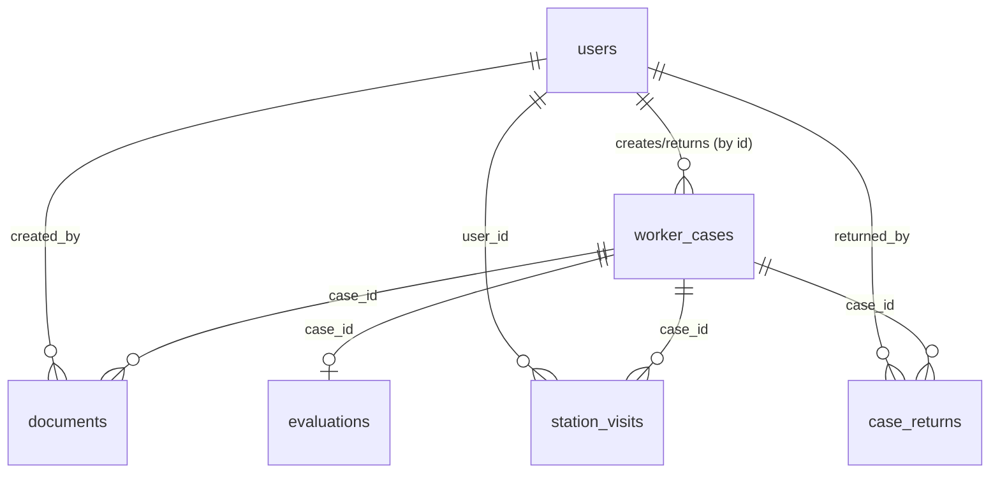

# Worker Testing App — Project Documentation (English)

> This document describes the code as it exists in the repository, not the design references in `docs/PRD.md`, `docs/DESIGN.md`, or the DGA HTML mockups. Where a requirement exists only in planning documents, it is explicitly marked. The Arabic companion file is `docs/doc_ar.md`.

---

## 1. Project Overview

| Item | Value |
|---|---|
| Project name | Worker Testing App / منصة اختبارات العمالة |
| Purpose | Replace paper-based worker testing with a four-station digital flow and produce exactly one Arabic PDF per worker for management |
| Target users | Four named staff roles: reception, theory lab, practical lab, and data review |
| Core workflow | Reception → Theory Lab → Practical Lab → Data Review → generate/download/print one Arabic PDF |
| Repository | `/home/ammar/Documents/wpdf` |
| Scope | MVP — all steps in `docs/PLAN.md` are marked `[x]` |

The system runs on a local LAN server with one device per station. There is no integration with any external platform; uploading to any other system is done manually outside this application.

The only delivered artifact is a seven-page Arabic PDF containing worker data, station timestamps, five photographs and the practical evaluation form with two signatures.

---

## 2. Current Implemented Features

Verified in code and tests:

- **Authentication (Laravel Breeze):** login, registration, logout, email verification, password reset/update/confirmation, and profile edit/delete. A `role` column was added to `users`.
- **Role-based landing and navigation:** `Role::landRoute()` sends reception to `/reception`, review to `/review`, theory and practical to `/dashboard`; navigation links are role-aware.
- **Reception:** create a worker case with name, passport number and unique ticket number; three photos (`worker_photo`, `passport`, `ticket`); inline camera capture **or** upload from device; duplicate ticket rejected with Arabic message; requirements checklist and server-side transition lock; returned-case list with note and direct resubmission to review.
- **Case search:** search by ticket number, display Arabic status, and links to theory/practical processing when status matches.
- **Theory station:** pending queue with instant search by name/ticket/passport, deep link to a case, one `theory_photo`, station summary, advance lock, returned-case banner and resubmit.
- **Practical station:** pending queue with instant search and returned badges, one `practical_photo`, fixed 13-criteria evaluation (task + difficulty + scores), two on-screen signatures with lock after signing, station summary, advance lock, returned-case banner and resubmit.
- **Review station:** queue of cases in `review` status, list of cases with an existing PDF, ordered document display, evaluation display, return to exactly one of reception/theory/practical with a text note (max 500 chars), signature wipe warning for practical returns, PDF generation, download and print links, "returned after correction" badges, station summary.
- **State machine:** all status changes go through `App\Services\CaseStateMachine`; missing requirements are reported by `App\Services\StationCompletion`.
- **PDF:** seven-page A4 Arabic RTL PDF rendered by Spatie Browsershot from a Blade template, with page numbering footer; PDFs are saved on the private disk.
- **Private image serving:** images are stored on the `local` disk and served only through an authenticated controller route.
- **Station access middleware:** `station:reception` and `station:review` are registered in `bootstrap/app.php` and applied to those two routes.
- **Tests:** 213 tests / 720 assertions pass at the time of writing.

---

## 3. Tech Stack

Installed versions from `composer.json` / `package.json` and `composer show --direct` inside the Sail container:

| Layer | Package / technology | Constraint | Installed (verified) |
|---|---|---|---|
| Language | PHP | `^8.3` | 8.5.x in `sail-8.5/app` container |
| Framework | `laravel/framework` | `^13.17` | 13.43.0 |
| UI (server) | `livewire/livewire` | `^4.0` | 4.4.8 |
| UI (client) | Alpine.js | `^3.4.2` (npm) | Bundled automatically by Livewire 4; `resources/js/app.js` contains no import |
| CSS | `tailwindcss` | `^4.3.5` | CSS-first `@theme` configuration, RTL |
| CSS plugin | `@tailwindcss/forms` | `^0.5.2` | Installed |
| Build | `vite` / `laravel-vite-plugin` / `@tailwindcss/vite` | `^8.0.0` / `^3.1` / `^4.3.5` | Installed |
| Fonts | `@fontsource/ibm-plex-sans-arabic`, `@fontsource/material-symbols-outlined` | `^5.3.0`, `^5.3.9` | Self-hosted (no CDN) |
| PDF | `spatie/browsershot` | `^5.5` | 5.5.0, requires `google-chrome-stable` at `/usr/bin/google-chrome-stable` |
| Auth | `laravel/breeze` | `^2.4` | 2.4.2 |
| Dev environment | `laravel/sail` | `^1.71` | 1.71.0, MySQL 8.4 service |
| Database | MySQL | — | `mysql:8.4` in `compose.yaml`; SQLite fallback in config |
| Queue | database driver | `QUEUE_CONNECTION=database` | Configured; no queued job classes exist in `app/Jobs` |
| Tests | `phpunit/phpunit` | `^12.5.12` | 12.5.45, run via `php artisan test` |
| Formatter | `laravel/pint` | `^1.27` | 1.32.3 |
| Diagnostics | `puppeteer` | `^25.18.1` | Installed as npm dependency; not used by application logic |
| Other dev | `laravel/boost`, `laravel/pail`, `laravel/pao`, `fakerphp/faker`, `mockery/mockery`, `nunomaduro/collision`, `laravel/tinker` | see `composer.json` | Installed |

Note: `AGENTS.md` describes the test framework as Pest; the actual suite uses PHPUnit-style `test_*` methods with `phpunit/phpunit` in `composer.json`.

---

## 4. System Architecture

Architecture is MVC, with business logic extracted into Actions, Services and Queries.

```text
Browser (RTL Blade + Livewire + inline Alpine)
        │  HTTP / Livewire update
        ▼
routes/web.php ── auth ── station:<role> (reception & review only)
        │
        ├── Livewire component (app/Livewire/*) or thin Controller
        │        ├── validates input (Livewire validate() / Validator / Form Request)
        │        ├── calls Actions (app/Actions/*)
        │        └── calls Services (app/Services/*)
        │
        ├── Actions: CreateWorkerCase, StoreCaseDocument, SaveEvaluation,
        │            SignEvaluation, ReturnCase, FindCaseByTicket, GenerateCasePdf
        ├── Services: CaseStateMachine, StationCompletion
        ├── Queries: PendingReceptionCases, PendingTheoryCases, PendingPracticalCases
        └── Models: WorkerCase, Document, Evaluation, StationVisit, CaseReturn, User
                 │
                 ▼
        MySQL (local Sail) + private filesystem (storage/app/private)
                 │
                 ▼
        Browsershot + Chrome → one PDF per case
```

Rules actually followed in the codebase:

- Models contain relationships, casts and small status helpers only.
- Controllers are thin (PDF download/print, private document response, Breeze profile).
- Status changes only through `CaseStateMachine`.
- Views contain UI and inline Alpine; queries live in Livewire components or `App\Queries`, not in Blade.

---

## 5. Project Structure

```text
app/
├── Actions/          Business operations (create case, store document, save/sign
│                     evaluation, return case, find by ticket, generate PDF)
├── Enums/            CaseStatus, Difficulty, Role, Station (with Arabic labels)
├── Exceptions/       IncompleteStationException (carries case, station, missing list)
├── Http/
│   ├── Controllers/  Thin controllers: PDF, private document, Breeze profile, Auth/
│   ├── Middleware/   EnsureStationAccess (station: alias)
│   └── Requests/     Breeze ProfileUpdateRequest
├── Livewire/         Reception, TheoryStation, PracticalStation, ReviewStation,
│                     CaseSearch, CameraCapture, *PendingCases components
├── Models/           Eloquent models and relationships
├── Queries/          Pending-case list queries with instant search
└── Services/         CaseStateMachine, StationCompletion
bootstrap/app.php      Registers the `station` middleware alias
config/                filesystems, livewire, database, queue, wpdf, Breeze configs
database/
├── migrations/       All domain tables plus Breeze/cache/jobs tables
├── factories/        Model factories
└── seeders/          DatabaseSeeder (four role accounts)
docs/                 PRD.md, PLAN.md, DATA_MODEL.md, DESIGN.md, this documentation
resources/
├── css/app.css       Tailwind 4 @theme tokens, base styles, .dga-* components
├── js/app.js         Intentionally empty — Livewire 4 boots Alpine itself
└── views/            Blade layouts, auth/profile, Livewire views, pdf/case-report.blade.php
routes/               web.php, auth.php, console.php
spikes/pdf-spike/     Step-0 PDF feasibility artifacts (not application runtime)
storage/app/private/  images and generated PDFs (never on the public disk)
tests/Feature/        HTTP, Livewire, PDF, role, storage and schema tests
```

---

## 6. Stations & Workflow

### Normal flow

| Step | Status value | Required to complete | Next |
|---|---|---|---|
| Reception | `reception` | Name, passport, ticket, `worker_photo`, `passport`, `ticket` | `theory` |
| Theory lab | `theory` | `theory_photo` | `practical` |
| Practical lab | `practical` | `practical_photo`, evaluation row, both signatures (`signed_at`) | `review` |
| Data review | `review` | All documents present, evaluation signed | PDF generation |
| Delivered | — | Download/print by review staff | Manual delivery outside the app |

`CaseStateMachine::advance()` re-checks `StationCompletion::missing()` on the server and throws `IncompleteStationException` with an Arabic message listing missing items. `completed` and `cancelled` are valid enum values, but no application code currently transitions a case into them. PDF generation does not change the case status.

### Return / correction flow

```text
review ──ReturnCase(case, station, note)──► returned
                                              │
                       target station fixes its own documents
                                              │
                       resubmitToReview() ────► review ──► generate PDF
```

- Only cases currently in `review` can be returned; the target must be `reception`, `theory` or `practical` (never `review`).
- The note is required and must be at most 500 characters at the Livewire form level.
- `ReturnCase` records a `case_returns` row, sets status to `returned`, and **deletes the `documents` rows belonging to the target station** inside a transaction.
- The underlying image files are not deleted by `ReturnCase`; they are deleted only when `StoreCaseDocument` replaces a document of the same case/station/type during a retake.
- If the target is **practical**, `evaluator_signature`, `worker_signature` and `signed_at` are all set to `null`. The evaluation's task, difficulty and 13 scores remain, but both signatures must be drawn again.
- Returns to reception or theory do not touch the evaluation signatures.
- After correction, the target station calls `resubmitToReview()`; only then can the review station select the case again.
- The review UI shows a "returned after correction" badge when `returns` exist.

---

## 7. Roles & Permissions

| Role | Enum value | Landing route | Navigation | Allowed station actions |
|---|---|---|---|---|
| Reception | `reception` | `reception` | Reception + case search | Create cases, capture/upload 3 documents, advance, fix returned cases, resubmit |
| Theory | `theory` | `dashboard` | Theory pending table via dashboard | Browse pending queue, select case, capture photo, advance, resubmit |
| Practical | `practical` | `dashboard` | Practical pending table via dashboard | Browse pending queue, save evaluation, sign twice, capture photo, advance, resubmit |
| Review | `review` | `review` | Review station | View all cases in review, return to one station, generate/download/print PDF |

Enforcement as actually implemented:

- `GET /reception` uses `station:reception`; `GET /review` uses `station:review`. On mismatch, `abort(403, 'غير مصرح لك بالدخول لهذه المحطة')`.
- `GET /theory/{case?}`, `GET /practical/{case}`, `GET /search`, `GET /documents/{document}`, PDF routes and profile routes require only `auth` — there is no additional server-side role check on those routes. This is a known limitation (see §16).
- Registration is open to guests; a newly registered user has no role and lands on `/dashboard` with a "no station assigned" notice.

---

## 8. Database Schema

Table and column names follow `docs/DATA_MODEL.md`; types below reflect the migrations as executed.

### `users`
`id`, `name`, `email` (unique), `email_verified_at` nullable, `password`, `rememberToken`, `role` enum (`reception|theory|practical|review`, nullable), `created_at`, `updated_at`.

### `worker_cases`
`id`, `full_name`, `passport_number`, `ticket_number` (unique), `status` enum (`reception|theory|practical|review|completed|returned|cancelled`, nullable), timestamps.

### `documents`
`id`, `case_id` FK → `worker_cases`, `station` enum (`reception|theory|practical`), `type` string, `path` string, `created_by` FK → `users`, `created_at` nullable. No `updated_at`.

Document types used: `worker_photo`, `passport`, `ticket` (reception), `theory_photo` (theory), `practical_photo` (practical).

### `evaluations`
`id`, `case_id` unique FK → `worker_cases`, `task`, `difficulty` enum (`easy|medium|hard`), `scores` JSON (keys 1–13, values 0–5), `evaluator_name`, `evaluator_id_number` (currently the evaluator's email), `evaluator_signature` and `worker_signature` nullable `text` data-URLs, `signed_at` nullable, `created_at` nullable. No `updated_at`.

### `station_visits`
`id`, `case_id` FK, `station` enum (`reception|theory|practical|review`), `user_id` FK, `started_at` nullable, `completed_at` nullable. No timestamps. The table and relationship exist, but no application code writes visit rows; PDF timestamps come from document `created_at` and `signed_at`.

### `case_returns`
`id`, `case_id` FK, `returned_to_station` enum (`reception|theory|practical`), `note` text, `returned_by` FK → `users`, `created_at` nullable. No `updated_at`.

### Framework tables
`password_reset_tokens`, `sessions`, `cache`, `cache_locks`, `jobs`, `job_batches`, `failed_jobs` from the Breeze/Laravel base migrations.

### Enums
`CaseStatus` (7 values with Arabic names), `Station` (4 values with Arabic names), `Role` (4 values with Arabic labels and landing route), `Difficulty` (3 values).

### Evaluation structure

| Section | Criteria numbers |
|---|---|
| فهم المشكلة وسير العملية | 1–5 |
| الأمن والسلامة | 6–9 |
| الأدوات والمعدات | 10–11 |
| الصحة والنظافة | 12–13 |

Scale: `0` غير مؤدٍ, `1` ضعيف, `2` أقل من المتوسط, `3` مرضٍ, `4` جيد, `5` ممتاز. There is no pass/fail threshold and no overall score; maximum is 65 by arithmetic only. Criteria are fixed constants in `SaveEvaluation::SECTIONS`; there is no form editor.

### ER diagram



---

## 9. Core Components

### CameraCapture (`app/Livewire/CameraCapture.php`, `resources/views/livewire/camera-capture.blade.php`)
- Camera logic is entirely inline Alpine in the Blade; `resources/js/app.js` is intentionally empty.
- Uses `getUserMedia({video:{facingMode:'environment'}})` with fallback to any camera, shows Arabic errors for denied/unavailable camera, and offers **"رفع من الجهاز"** as a fallback.
- Client-side compression: draw to canvas, max dimension 1600 px, JPEG quality 0.72; a black-frame check warns the user before capture.
- Both paths converge on `saveImage(string $imageData)`. Server validation order: strict `data:image/(jpeg|png);base64` regex → strict `base64_decode(..., true)` → ≤ 5 MB → `getimagesizefromstring()` sniff.
- Writes through `StoreCaseDocument` to `cases/{caseId}/{station}/{type}.{ext}` on the `local` disk; retaking the same type deletes the old file and updates the row.
- Dispatches `case-document-stored` so the parent station refreshes its checklist; Livewire 4 listeners use `#[On(...)]`.

### Signature pad (`resources/views/livewire/partials/signature-pad.blade.php`, inline script in `practical-station.blade.php`)
- Canvas 600×150 with pointer events, exports `data:image/png;base64,...` into a hidden `wire:model` input.
- `SignEvaluation` validates the data-URL pattern and a 2 MB decoded-size limit, then sets `signed_at`. After signing, both `SaveEvaluation` and `SignEvaluation` reject further changes with Arabic errors.

### Station dashboards and tables
- `App\Queries\PendingTheoryCases` / `PendingPracticalCases` include normal pending cases and cases returned to that station; `PendingReceptionCases` lists only cases returned to reception.
- Instant search matches name, ticket and passport. Tables show return badges, note, who returned the case and photo status via `withExists`.

### Station summary (`resources/views/components/station-summary.blade.php`)
Shows current station name, user role, completed/missing requirements with counts, and transition state label ("ناقص", "مكتمل", or "جاهز للمحطة التالية" with the next station name).

### PDF generation (`app/Actions/GenerateCasePdf.php`, `resources/views/pdf/case-report.blade.php`)
- Validates all five images plus signed evaluation before rendering; throws `LogicException` listing missing items.
- Renders Arabic RTL Blade HTML, embeds images as base64 data URIs, then calls Browsershot with A4 format, explicit Chrome path, `--no-sandbox --disable-dev-shm-usage`, 500 ms delay and network-idle wait.
- Saves to `cases/{caseId}/pdf/{ticket}_{Y-m-d}_v1.pdf` on the private disk.

### Document image controller (`app/Http/Controllers/DocumentImageController.php`)
Authenticated `GET /documents/{document}`; checks case existence and private file existence, then returns a storage response with detected MIME type.

### Return case action (`app/Actions/ReturnCase.php`)
Transactionally calls `CaseStateMachine::returnTo()`, writes the `case_returns` row, deletes target-station document rows, and clears all signature fields when returning to practical.

---

## 10. Routes

All routes below are defined in `routes/web.php` unless noted. Breeze auth routes come from `routes/auth.php`.

| Method | URI | Handler | Middleware / role | Purpose |
|---|---|---|---|---|
| GET | `/` | closure → `welcome` | public | Landing page |
| GET | `/dashboard` | closure → `dashboard` | `auth`, `verified` | Role-aware dashboard; theory/practical pending tables |
| GET | `/login`, POST `/login` | `AuthenticatedSessionController` | `guest` | Login, role-aware redirect |
| GET/POST | `/register` | `RegisteredUserController` | `guest` | Registration (new users have no role) |
| GET/POST | `/forgot-password`, `/reset-password/{token}` | Breeze controllers | `guest` | Password reset |
| GET | `/verify-email...`, POST `/email/verification-notification` | Breeze controllers | `auth` | Email verification |
| GET/POST | `/confirm-password`, PUT `/password`, POST `/logout` | Breeze controllers | `auth` | Password confirmation/update, logout |
| GET | `/reception` | `App\Livewire\Reception` | `auth`, `station:reception` | Create cases and capture reception documents |
| GET | `/search` | `App\Livewire\CaseSearch` | `auth` | Search by ticket number |
| GET | `/theory/{case?}` | `App\Livewire\TheoryStation` | `auth` | Theory queue and processing |
| GET | `/practical/{case}` | `App\Livewire\PracticalStation` | `auth` | Practical evaluation and signatures |
| GET | `/review` | `App\Livewire\ReviewStation` | `auth`, `station:review` | Review, return, PDF |
| GET | `/documents/{document}` | `DocumentImageController@show` | `auth` | Serve private image |
| GET | `/pdf/{case}` | `CasePdfController@download` | `auth` | Download latest PDF |
| GET | `/pdf/{case}/print` | `CasePdfController@print` | `auth` | Inline PDF for printing |
| GET/PATCH/DELETE | `/profile` | `ProfileController` | `auth` | Breeze profile |

---

## 11. File Storage & PDF

- `config/filesystems.php`: default disk `local`, root `storage/app/private`. The `public` disk exists in config but is not used for worker images.
- Image path: `cases/{case_id}/{station}/{type}.{jpg|png}` on the private disk; DB stores the relative path only.
- PDF path: `cases/{case_id}/pdf/{ticket_number}_{Y-m-d}_v1.pdf`; the controller picks the lexically latest `.pdf` in that directory for download/print.
- PDF name is generated with version `v1` on every generation; there is no versioning UI and no "delivered" state.
- Browsershot needs Google Chrome at `/usr/bin/google-chrome-stable` (installed by `docker/Dockerfile`); arguments `no-sandbox` and `disable-dev-shm-usage` are required in the container.
- PDF template is `dir="rtl"`, `lang="ar"`, uses self-hosted IBM Plex Sans Arabic with Noto fallbacks, A4 pages 210×297 mm, page footer "منصة اختبارات العمالة — صفحة x من y".
- Page order: (1) worker data + station times, (2) worker photo, (3) passport, (4) ticket, (5) theory photo, (6) practical photo, (7) evaluation table + signatures.
- The first page has no staff names or version; version appears only in the filename. Evaluation page includes evaluator name and ID number.

---

## 12. Design System

The UI is Arabic RTL. `resources/css/app.css` is the authoritative source of design tokens (the older `docs/DESIGN.md` lists different, stale colours and fonts).

| Aspect | Actual implementation |
|---|---|
| Font | IBM Plex Sans Arabic (weights 300–700) via `@fontsource`, `--font-sans` |
| Icons | Material Symbols Outlined via `@fontsource`, self-hosted |
| Primary | `#004328` (`primary`), container `#0d5c3a`, light `#8ad2a7` |
| Navy / ink | `#101b30` / `#191c1e`; surfaces `#f7f9fb` → `#ffffff` |
| Semantic | `error #ba1a1a`, `success` = primary-container, `warning` = tertiary-container `#664d00` |
| Layout | Fixed right sidebar (`w-72`, 288 px) + fixed top header (`h-16`, 64 px); main content padded; mobile sidebar toggled by Alpine |
| Components | `.dga-card`, `.dga-card-header`, `.dga-card-body`, `.dga-btn*`, `.dga-badge`, `.dga-table` |
| Radius | Small MD3-style radii (`--radius`, `--radius-lg`, `--radius-xl`); `rounded-full` uses Tailwind's default full-pill value |

No QR, OCR, biometric or government-platform logos are present in the UI; no external services are called.

---

## 13. Local Development Setup

```bash
# 1. Start Sail (app on port 80, MySQL 8.4, Mailpit)
cp .env.example .env
./vendor/bin/sail up -d

# 2. Install PHP and JS dependencies
./vendor/bin/sail composer install
./vendor/bin/sail npm install

# 3. App key, migrations, seed accounts, build assets
./vendor/bin/sail php artisan key:generate
./vendor/bin/sail php artisan migrate --force
./vendor/bin/sail php artisan db:seed
./vendor/bin/sail npm run build
```

The application is served on `http://localhost/` when `APP_PORT=80` (the checked-in `.env` sets `APP_URL=http://localhost:8000`, which is only used for URL generation; Sail maps port 80 by default). Tests use the separate `testing` MySQL database created by Sail's MySQL init script.

Seeded accounts (from `DatabaseSeeder.php`, password `password123` for all):

| Role | Email |
|---|---|
| Reception | `reception@wpdf.test` |
| Theory | `theory@wpdf.test` |
| Practical | `practical@wpdf.test` |
| Review | `review@wpdf.test` |

> `README.md` contains older account names/passwords; the seeder above is authoritative.

Chrome/Puppeteer: `google-chrome-stable` is installed inside the container and used by Browsershot. `puppeteer` in `package.json` is used only for local diagnostics; no application code imports it.

Storage permissions fix if bind-mounted files are owned by a different UID:

```bash
chmod -R g+w storage config bootstrap/cache
# or
docker compose exec -u root -T laravel.test \
  sh -c "chown -R 1000:1000 /var/www/html/storage /var/www/html/bootstrap/cache"
```

Livewire's `payload.max_size` is configured in bytes (`5 * 1024 * 1024`) in `config/livewire.php`.

---

## 14. Testing

```bash
./vendor/bin/sail php artisan test
./vendor/bin/sail php artisan test --filter=ReturnCaseTest
./vendor/bin/sail ./vendor/bin/pint --test
```

Current result: **213 tests, 720 assertions**. Main suites:

| Test file(s) | Coverage |
|---|---|
| `AuthenticationTest`, `RegistrationTest`, `Password*Test`, `EmailVerificationTest`, `LogoutRegressionTest` | Breeze auth flows |
| `ReceptionTest`, `StationAccessTest`, `StationCompletionTest`, `StationSummaryTest` | Case creation, duplicate ticket, transition lock, role gate, summaries |
| `CameraCaptureTest`, `CameraCaptureUploadTest`, `StoreCaseDocumentTest` | Data-URL validation, upload fallback, private disk paths, retake replacement |
| `CaseSearchTest`, `TheoryStation*Test`, `Practical*Test`, `RoleNavigationTest` | Queues, instant search, evaluation, signatures, navigation |
| `ReturnCaseTest`, `ReturnedCasesUxTest`, `CaseStateMachineTest` | Return rules, signature wipe, resubmission, status transitions |
| `ReviewStationTest`, `PdfGenerationTest`, `PdfSpikeTest` | Review UI, PDF completeness, A4/RTL/tashkeel, download/print |
| `SchemaTest`, `UserRoleTest`, `WpdfConfigTest` | Tables/relations, role casts, config values |

`phpunit.xml` forces `CACHE_STORE=array`, `SESSION_DRIVER=array`, `QUEUE_CONNECTION=sync`, `MAIL_MAILER=array` and `DB_DATABASE=testing`.

---

## 15. Security & Privacy

Implemented:

- Passport and worker images are stored only on the private disk; no image is written to the public disk (`StoreCaseDocumentTest` asserts this).
- Image access goes through an authenticated route that resolves the MIME type server-side.
- Station middleware denies reception/review access to users of other roles with the required Arabic 403 message.
- Signature payloads are pattern-checked and size-limited; evaluation editing and signing are locked after `signed_at`.
- All runtime data stays on the local server; no external API or cloud service is called.

Privacy notes:

- Worker names, passport numbers, photos and handwritten signatures are sensitive personal data. The PRD requires PDPL-compliant handling and encryption in transit/at rest; concrete encryption-at-rest and transport enforcement are **Not available in the current codebase**.
- No audit log, retention policy or deletion workflow exists in MVP.

Current limitations (honest):

- `/documents/{document}`, PDF routes, `/theory`, `/practical` and `/search` are protected by `auth` only; any authenticated user can request them directly.
- Open registration allows any visitor to create an account (with no role).
- No rate limiting on login/search, and no CSRF exception is needed because standard web middleware is used.
- `evaluator_id_number` stores the evaluator's email, not a national ID.

---

## 16. Known Limitations

- Only `/reception` and `/review` have role middleware; other station/search/document/PDF routes lack server-side role checks.
- `completed` and `cancelled` statuses exist but no code sets them; the review queue filters on `review` and treats a case as PDF-complete based on the presence of a file.
- `station_visits` is never populated; PDF times are derived from document/signature timestamps.
- `config('wpdf.professions')` exists but is not used by any view; the practical evaluation task is free text.
- `ReturnCase` deletes document rows for the target station; this differs from the AGENTS.md "no image deletion in MVP" note (files themselves are deleted only on retake).
- PDF version is hardcoded to `_v1`; regenerating overwrites the same filename.
- Camera capture requires a secure browsing context (`localhost`/HTTPS) for `getUserMedia`; the upload fallback covers denial or unsupported devices.
- `README.md` and `docs/DESIGN.md` are stale relative to the code (accounts, fonts, colours, layout).
- No queued jobs exist despite the database queue driver being configured.
- No offline/sync, admin panel, metrics/CSV, audit viewer, PDF versioning UI, form editor, QR/OCR, notifications, payments, archiving/deletion or delivery-tracking button.
- No external services (Qiwa, Absher, Nafath, Muqeem, etc.) are integrated — see §17.

---

## 17. Future Expansion Guide

### Not implemented — belongs here until built
Qiwa, Absher, Nafath, Muqeem, government platform integrations, QR codes, OCR, biometric identity checks, AI camera verification, and external notifications are **Not available in the current codebase**. The DGA HTML reference is visual only.

Also deferred: offline/sync queues, admin UI, metrics/CSV and delivery button, detailed audit log, item-specific returns, PDF versioning UI, form editor, archiving/deletion.

### Adding a new station
1. Add the value to `App\Enums\Station` and `CaseStatus` with an Arabic label.
2. Add a migration if new tables/columns are needed; never rename existing ones from `docs/DATA_MODEL.md`.
3. Create a Livewire component in `app/Livewire/` + view in `resources/views/livewire/`.
4. Add requirements to `StationCompletion::requirements()` and the next hop to `CaseStateMachine::nextStation()`.
5. Add the route in `routes/web.php` with the appropriate `station:` middleware, then a role-gated nav link.
6. Add tests for access, completion, transition and summary.

### Adding a document type
Add the `type` string to the station's requirements in `StationCompletion`, add its Arabic label to `GenerateCasePdf::DOCUMENT_LABELS` and `REQUIRED_DOCUMENTS` only if it must appear in the PDF, and use the existing `StoreCaseDocument` path pattern. Update the PDF template if a new page is needed.

### Adding a role
Add the enum case in `Role`, add it to the `users.role` enum migration, update `landRoute()`, navigation and dashboard logic, create a `station:`-guarded route, and seed a test account.

### Modifying evaluation criteria
Edit `SaveEvaluation::SECTIONS` and `SCALE` only. Update `resources/views/livewire/practical-station.blade.php` for labels and `resources/views/pdf/case-report.blade.php` if the table format changes. Treat existing stored `scores` JSON as historical data.

### Reports / API / notifications later
Introduce versioned API routes with Eloquent API Resources, dedicated Form Requests and policies; use the already configured `database` queue for jobs; keep all personal data on the private disk and add explicit authorization before exposing documents or PDFs.

---

## 18. Troubleshooting

| Problem | Check / fix |
|---|---|
| PDF generation fails | Confirm `google-chrome-stable` exists in the container at `/usr/bin/google-chrome-stable`; Browsershot passes `--no-sandbox` and `--disable-dev-shm-usage`. Check all five documents and both signatures exist; `GenerateCasePdf` reports missing items. |
| "Unable to locate file in Vite manifest" | Run `npm run build` (or `./vendor/bin/sail npm run build`) after CSS/view changes. |
| 403 on a station | `station:` middleware compares `user.role` with the station; log in with the matching seeded account. Remember theory/practical rely on navigation only. |
| Permission denied on `storage/logs` | `chmod -R g+w storage config bootstrap/cache`, or `docker compose exec -u root -T laravel.test sh -c "chown -R 1000:1000 /var/www/html/storage /var/www/html/bootstrap/cache"`. |
| Livewire component has no root element | Every Blade component/template must have one root `<div>`; Livewire 4 morph markers rely on it. |
| Alpine `x-ref` / canvas not working | Camera and signature logic are inline in Blade; do not move them to `resources/js/app.js`. Ensure canvas has `x-ref="canvas"` and the hidden input has `x-ref="input"`. In Livewire 4 use `#[On('event-name')]`, not `#[Listen]`. |
| Camera denied / blank frame | Grant camera permission, use `http://localhost` or HTTPS, or use "رفع من الجهاز"; a black-frame warning appears before saving. |
| Login/seed problems | Run `php artisan db:seed`; use `reception@wpdf.test` etc. with `password123`. Fresh installs need `key:generate`. |
| Images not visible in review/PDF | Check `storage/app/private/cases/{id}/...` and the `documents.path` rows; review hides documents whose private file is missing. |
